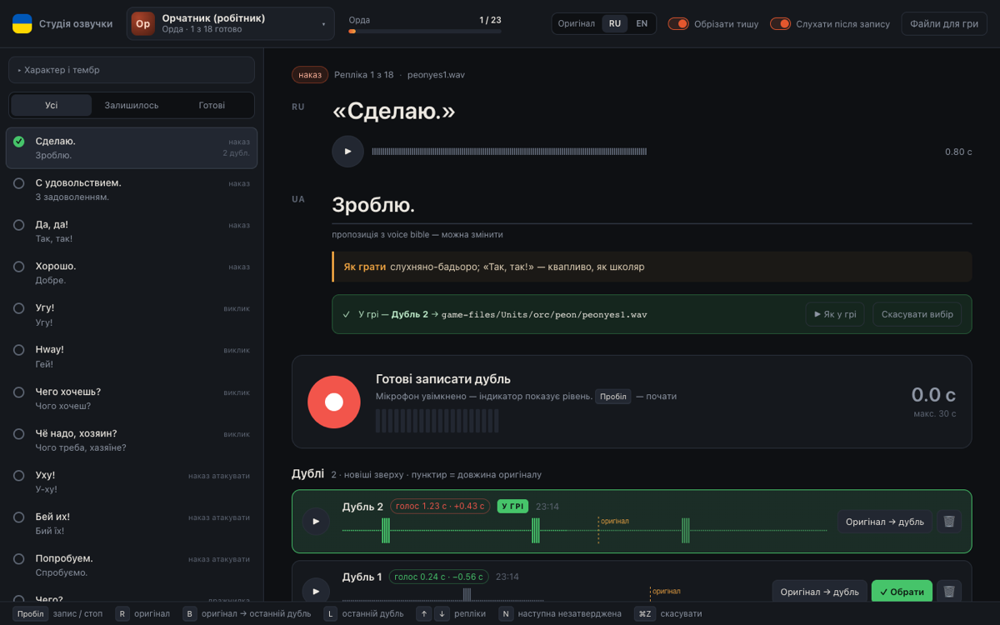

# Українська озвучка Warcraft III

[](https://github.com/Stolenskiy/WarCraft3-Ukrainianization/actions/workflows/ci.yml)

**Що це.** Фанатський некомерційний проєкт: повна **українська голосова озвучка** юнітів
Warcraft III Classic (а згодом — кампанійних місій), плюс уже готова текстова українізація
меню, текстів і карт. Офіційної української озвучки гри ніколи не існувало.

**Для чого.** Щоб піони, ґрунти й лицарі заговорили українською — живою мовою, з характером,
у хронометражі оригіналу. Озвучуємо **власними голосами** в локальній студії запису
(і, можливо, згодом — AI-синтезом).

**Кому корисно.** Гравцям, які хочуть грати українською; **акторам-аматорам і всім із
мікрофоном**, хто хоче озвучити улюбленого юніта; **редакторам тексту** (без коду) —
українські репліки й характери персонажів; розробникам — інструменти й тести.



## Встановлення

Є два незалежні пакети: **текст** (переклад меню, назв, підказок із гарячими клавішами) і **голос** (озвучка юнітів). Усе ставиться «вільними» файлами
(потрібен «Allow Local Files»), спершу показується план, у гру пишемо лише з `--apply`, відкат — однією командою.

| Версія гри | Текст | Голос | Інструкція |
|---|---|---|---|
| Classic 1.31 (RoC + TFT; macOS-репак, Windows) | підтримується (macOS перевірено; Windows — ні) | підтримується | [docs/install/classic-1.31.md](docs/install/classic-1.31.md) |
| Reforged 1.32+ / 2.x / 3.x | EXPERIMENTAL, не перевірено | EXPERIMENTAL, не перевірено | [docs/install/reforged.md](docs/install/reforged.md) |
| Класичні 1.26–1.29 (MPQ) | EXPERIMENTAL, не перевірено | EXPERIMENTAL, не перевірено | [docs/install/legacy.md](docs/install/legacy.md) |

Три шляхи (приклад для Classic 1.31; `--target reforged|legacy` для інших; без `--apply` — лише план):
- **лише текст:** `python tools/run.py install --target classic-1.31 --parts text --apply` (`make install-text APPLY=1`);
- **лише голос:** `python tools/run.py install --target classic-1.31 --parts voice --apply` (`make install-voices APPLY=1`);
- **усе разом:** `python tools/run.py install --target classic-1.31 --parts text,voice --apply` (`make install APPLY=1`).

Текст завантажується з [warcraft-in-ua](https://github.com/warcraft-in-ua/WarCraft3-Reforged-Ukrainian) (найновіша версія; `--ref` фіксує, `--full` додає кампанії)
у локальний кеш: у цьому репозиторії чужих файлів немає ([ADR 0006](docs/decisions/0006-text-pack-sourcing.md)). Відкат: `python tools/run.py uninstall --target … --parts text,voice`.

## Платформи

Усе, що вміє `make`, вміє й `python tools/run.py <команда>` (stdlib; `--help` — список): це шлях для Windows без make.
Тека гри визначається так: змінна `WC3_GAME_ROOT` → `data/local/settings.json` → автопошук; змінити: `python tools/run.py game-root <шлях>`.

**macOS** (`brew install python@3.11 ffmpeg node`):
`git clone … && cd WarCraft3-Ukrainianization && make setup && make doctor && make studio`

**Windows 10/11** (`winget install Python.Python.3.11 Gyan.FFmpeg OpenJS.NodeJS.LTS Git.Git`; або `choco install python311 ffmpeg nodejs git`):
`git clone … ; cd WarCraft3-Ukrainianization ; python tools/run.py setup ; python tools/run.py doctor ; python tools/run.py studio`
(Chrome або Edge; «Allow Local Files» у реєстрі — [docs/install-local.md](docs/install-local.md#windows)). Не перевірено на реальній Windows: див. `docs/gotchas.md`.

**Linux** (`sudo apt install python3.11 python3.11-venv ffmpeg nodejs`, або `pipx install uv`):
`make setup && make doctor && make studio` (або `python3 tools/run.py …`). Гра під Wine/Lutris/Proton знаходиться автоматично, інакше `game-root`.

**Docker** (лише студія; потрібен запущений Docker Desktop / docker engine):
`docker compose up --build` (або `python tools/run.py docker`) → http://127.0.0.1:8765. Мікрофон працює, бо браузер на хості;
записи лежать у `audio/`, `data/`, `game-files/` на хості. Теку гри додайте `GAME_DIR=/шлях` (лише читання; `GAME_MODE=rw` — для встановлення).
Порт хоста має бути 8765 (перевірка Host). Немає в контейнері: ШІ-варіанти (Fish на Apple MPS) і `make refs`. Встановлюйте голоси в гру
з хоста (`install-voices`): симлінки через bind-монти Docker Desktop працюють непевно.

## Як поставити готовий голосовий пакет без студії

Лише слухати українську озвучку, нічого не записуючи: склонуйте репозиторій і поставте Python 3.11 (див. вище), далі
`python tools/run.py game-root` (перевірити теку гри) → `python tools/run.py install-voices` (план) → `python tools/run.py install-voices --apply`.
Голоси беруться з `voices/<автор>/` (обрані автори — у студії, «Голоси спільноти»; без вибору береться локальна `game-files/`).
Вручну: скопіюйте FLAC→WAV 22050 Гц mono з `voices/<автор>/units/…` в корінь гри за тим самим шляхом (`Units/orc/peon/…`) —
але теки-симлінки й бекап безпечніше віддати інсталятору. Відкат: `python tools/run.py uninstall-voices`.

## Як долучитися локально (озвучити своїм голосом)

Потрібні: Mac, Windows або Linux (див. «Платформи»), Python 3.11 (або [uv](https://docs.astral.sh/uv/) — поставить сам), `ffmpeg`, Google Chrome, мікрофон і **власна
копія Warcraft III Classic** (оригінальні голоси беруться з неї; у репозиторії аудіо гри немає).

1. **Склонувати й налаштувати:**
   `git clone https://github.com/Stolenskiy/WarCraft3-Ukrainianization.git && cd WarCraft3-Ukrainianization && make setup`
2. **Витягти оригінали з гри:** `make refs` — англійські голоси з вашої гри (~5 хв).
   Гра не в `/Applications/Warcraft III Classic`? — `WC3_GAME_ROOT=/шлях make refs`.
   Російські (необов'язково) — якщо маєте російську локалізацію гри, вкажіть теку `ruru.w3mod`:
   `RU_PACK=<…>/Localizations/Russian/ruru.w3mod make refs`.
3. **Запустити студію:** `make studio` → відкриється http://127.0.0.1:8765 (усе офлайн).
4. **Озвучити:** раса й юніт угорі → послухати оригінал (`R`; мова **RU/EN** — перемикач
   «Оригінал») → прочитати «Як грати» → `Пробіл` запис / стоп → порівняти (`B`) →
   **✓ Обрати** найкращий дубль. Усе змінюване: кошик, `⌘Z`.
5. **Почути в грі:** у студії кнопка **«Встановити в гру»** (показує план → «Встановити»;
   «Прибрати з гри» — відкат). Те саме з терміналу: `make install-voices` (план) →
   `make install-voices APPLY=1`; відкат — `make uninstall-voices`. Обрані дублі з `game-files/`
   копіюються в гру з бекапом; теки юнітів-симлінків (`Units/orc/grunt` → `Mods/...`) стають
   реальними текою з симлінками на оригінальні файли, `Mods/` не змінюється.
6. **Поділитися:** тексти й характери — PR у `docs/voice-bible/`; записи — домовтеся
   в Issues (аудіо в репозиторій не комітимо). Детально — [docs/CONTRIBUTING.md](docs/CONTRIBUTING.md).

---

## Озвучка спільноти: як поділитися своїм голосом і обрати чужий

Кожен може опублікувати свої затверджені дублі й використати голоси інших авторів — окремо для раси, персонажа чи репліки.

1. Запишіть і оберіть дублі в студії (`make studio`, «Обрати для гри») — вони лежать у `game-files/`.
2. Студія → **«Голоси спільноти»** → нікнейм (лише `a-z`, `0-9`, `-`) → позначте «Це мій власний голос; дозволяю використання
   за ліцензією CC BY 4.0» → **«Опублікувати»**. Те саме з терміналу: `make publish-voice AUTHOR=<нік> CONSENT=1`.
   Файли (FLAC, готові для гри) з'являться в `voices/<нік>/`; git код не запускає — покаже команди (гілка, коміт, пуш, PR).
3. Відкрийте PR (див. `docs/CONTRIBUTING.md`); CI перевірить формат, маніфест і ліцензію (`make check-voices`).
4. Щоб користуватися чужими голосами: оновіть репозиторій → «Голоси спільноти» (порядок пріоритету авторів) →
   **«Встановити в гру»** → у списку оберіть автора для раси чи персонажа (або окремої репліки), ▶ — послухати → «Встановити».
   `make install-voices` бере збережений вибір (`data/studio/voice-choice.json`, локальний).

Автор `local` — ваші власні, ще не опубліковані дублі. Якщо обраний автор не озвучив репліку, береться наступний за порядком.

## Що вже зроблено

- **Текстова українізація** меню 1.31, текстів і 203 карт — встановлюється в гру
  ([docs/ukrainian-ui-131.md](docs/ukrainian-ui-131.md), [docs/ukrainian-maps.md](docs/ukrainian-maps.md)).
- **Інвентар** 2401 голосового файлу 155 юнітів (`data/inventory-units.csv`) і тривалості
  оригінальних реплік (`data/transcripts-*.json`; самі російські тексти — локально в `data/local/`, не в git).
- **Voice bible** — 55 аркушів персонажів 4 рас: характер, тембр, українські репліки,
  «як грати» ([docs/voice-bible/](docs/voice-bible/README.md)).
- **Студія запису** власним голосом з оригіналом RU/EN ([tools/studio/README.md](tools/studio/README.md)).
- **TTS-експерименти** (Piper, XTTS-v2, Fish Speech із generic-голосами) — не дотягли до планки якості
  ([docs/improve-and-elevenlabs.md](docs/improve-and-elevenlabs.md)); **ШІ-варіанти власним голосом** (Fish Speech S2-Pro,
  клон із ваших дублів, `make ai-voice`) — окремий розділ у студії, завжди з позначкою «ШІ».
- Поточний стан і наступні кроки — [docs/STATUS.md](docs/STATUS.md).

## Як влаштований конвеєр

```text
гра (репак)                      наш репозиторій
┌──────────────────┐
│ російська        │  витягнути          reference/units/orc/peon/*.wav
│ озвучка (еталон) │ ────────────────►          │
└──────────────────┘                            │ tools/transcribe.py
                                                │ (mlx-whisper large-v3-turbo)
                                                ▼
                                     data/local/transcripts-orc-peon.json
                                                │
                                                │ редактор тексту (людина!)
                                                ▼
                                     docs/voice-bible/orc.md
                                     (характер, тембр, українські фрази
                                      + «як озвучувати»)
                                                │
                                                │ власний голос у студії
                                                │ (або TTS — ElevenLabs, на паузі)
                                                ▼
                                     game-files/Units/orc/peon/*.wav
                                                │ найкращий дубль (вуха!)
                                                ▼
корінь гри ◄──────────────────  Units/orc/peon/peonyes1.wav
Warcraft III Classic            (loose-файл поверх CASC,
 Allow Local Files = 1)          той самий шлях, що в оригіналі)
```

Технічна основа інтеграції — той самий механізм, яким репак підключає
російську озвучку та Reforged-пакети: **loose-файли в корені гри** зі шляхами,
що дзеркалять CASC (`Units/orc/peon/peonyes1.wav`), і опція
`Allow Local Files`. Деталі — в `docs/integration.md`.

## Планка якості

Правила зафіксовані в `docs/voice-bible/README.md`, коротко:

1. **Характер > краса.** Голос упізнається за перші 0.5 секунди; кожен юніт —
   архетип.
2. **Расова палітра.** Люди — суха «казарма/собор», орки — низький степ,
   нежить — холодний склеп, ельфи — нічний ліс. Індивідуальність — всередині
   палітри.
3. **Хронометраж.** Українська фраза вписується в тривалість оригіналу
   (тривалості є в `data/inventory-units.csv`). Не влазить — переписуємо
   текст, не розтягуємо звук.
4. **Жива українська мова.** Без суржику, без русизмів.
5. **Не клонуємо голоси реальних акторів.** Тільки спроєктовані або
   бібліотечні голоси.

## Дорожня карта

1. **Голосові біблії по расах** ✅ — усі 4 раси, 55 юнітів.
2. **Студія запису власним голосом** ✅ — озвучуємо Орду ← *ми тут*.
3. **TTS-рушій — власний голос.** Generic-голоси (Piper / XTTS-v2 / Fish) не дотягли до планки, ElevenLabs — на паузі
   (`docs/improve-and-elevenlabs.md`). Тепер локально клонуємо **власний голос учасника з його дублів**
   (Fish Speech S2-Pro, `make ai-voice`): ШІ-варіанти реплік у студії для порівняння «мій дубль ↔ ШІ ↔ оригінал» ← *PoC на Орчатнику*.
4. **Озвучка по юнітах.** Роботяга → Ґронт → …: масова генерація,
   обробка расовою палітрою, QA по тривалості й гучності.
5. **Реліз для melee/локальної гри.** Голосовий пак «поклади папку — і грає»
   (`docs/install-local.md`).
6. **Кампанійні місії.** Діалоги місій, транскрипція, адаптація за глосарієм
   термінів, генерація по персонажах, синхронізація з сінематиками.

## Етика і ліцензії

- Це **фанатський, некомерційний проєкт** для власників гри. Ніяких продажів,
  донатів, реклам. **Blizzard не має до проєкту стосунку**; Warcraft III —
  торговельна марка Blizzard Entertainment.
- **Не клонуємо голоси реальних акторів** для публічного поширення —
  ні оригінальних англійських, ні російських акторів озвучки. Еталонні
  російські wav використовуються лише як технічний референс тембру в межах
  команди; у реліз потрапляють тільки синтезовані голоси або записані учасниками
  власним голосом (за їхньою згодою).
- **ШІ-голос — лише власний голос учасника**, клонований із його ж дублів за його бажанням, локально (без хмари
  й завантаження аудіо). Усі такі файли й дублі позначені **«ШІ»** (`audio/ai/…`, `source: "ai"`); голосовий пак із
  ними мусить явно вказувати, які репліки синтезовані. Генерація локальна, `reference*/` голосом не слугує.
- Ліцензії моделей: **XTTS-v2 — Coqui Public Model License (CPML)**;
  **Fish Speech S2-Pro — Fish Audio Community License** (ваги — Fish Audio
  Research License) — **некомерційна**: комерційно ні модель, ні її вихід не використовуємо. Обидві дозволяють
  некомерційне використання такого роду; перед релізом звіримо умови ще раз.
- Розповсюдження — тільки як мод-файли до легальної копії гри, окремо від неї.

## Ліцензії

- **Код і документація** — MIT ([LICENSE](LICENSE)).
- **Пакети голосів** (`voices/<автор>/`) — CC BY 4.0, лише власний голос автора, без аудіо Blizzard, ШІ-репліки позначені
  ([voices/LICENSE.md](voices/LICENSE.md)).
- **Ігрові ресурси** (аудіо, тексти, моделі Warcraft III) належать Blizzard Entertainment і сюди **не входять**:
  потрібна власна копія гри.

## Для AI-агентів

Єдине джерело інструкцій — [AGENTS.md](AGENTS.md) (команди, карта, межі, процес); стан — [docs/STATUS.md](docs/STATUS.md).

## English summary

Non-commercial fan project: a full **Ukrainian voice-over** for Warcraft III Classic units
(campaign later), plus an installed Ukrainian text localization. Contributors record lines
**with their own voice** in a local browser studio (`make setup && make refs && make studio`):
listen to the Russian or English original, record takes, pick the best one — it is exported
in the game's format and dropped into the game root as a loose file. Requires your own copy of
the game; no game audio is published here. Agents: start with `AGENTS.md` and `docs/STATUS.md`.
